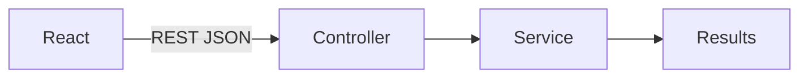

# TestForge AI

API response validation — Java 21 / Spring Boot and React TypeScript portfolio starter.

## v0.1: Implemented
Checks top-level fields in supplied JSON against expected text values; does not send network requests.

- Editable sample input, REST endpoint and result display.
- Bounded input, service/controller separation and unit tests.
- Docker Compose and CI configuration.

This is deterministic demo logic, not an LLM integration. No API key required.

## Run locally
```sh
docker compose up --build
```
Open http://localhost:3000. Alternatively run `mvn spring-boot:run` in backend and `npm install && npm run dev` in frontend. Requires Java 21, Maven and Node 22.

## Demo
Click **Validate** with the preloaded sample and inspect the results. Edit the input to explore behavior.

## API
POST /api/demo with JSON fields input and query (strings). Returns a JSON object containing a results array; invalid input returns HTTP 400.

## Architecture

See [architecture notes](docs/architecture.md).

## Tests
`mvn -f backend/pom.xml test` and `cd frontend && npm install && npm run build`. CI configuration is supplied; build and runtime verification are pending.

## Roadmap (not implemented)
OpenAPI import, sandboxed request execution, contract testing, test generation and reports. Persistence, authentication, production security, AI evaluation and public deployment are future milestones.

## Security
Local synthetic-data demo only. Do not expose to untrusted traffic or use confidential data.
